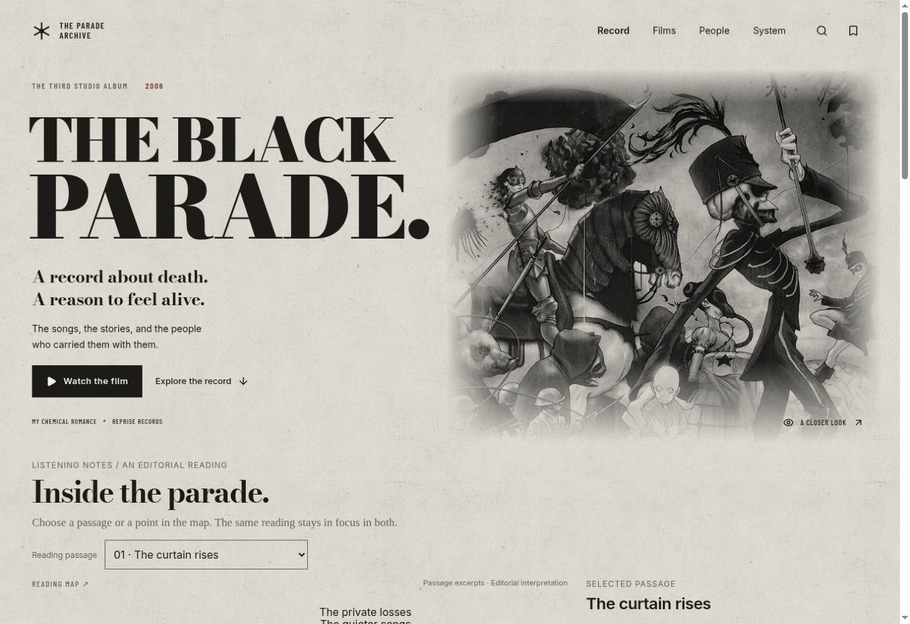
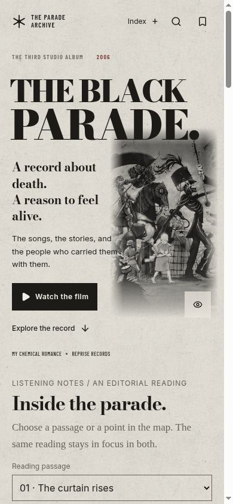
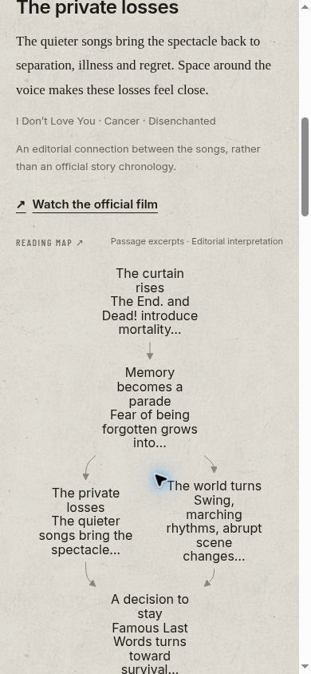
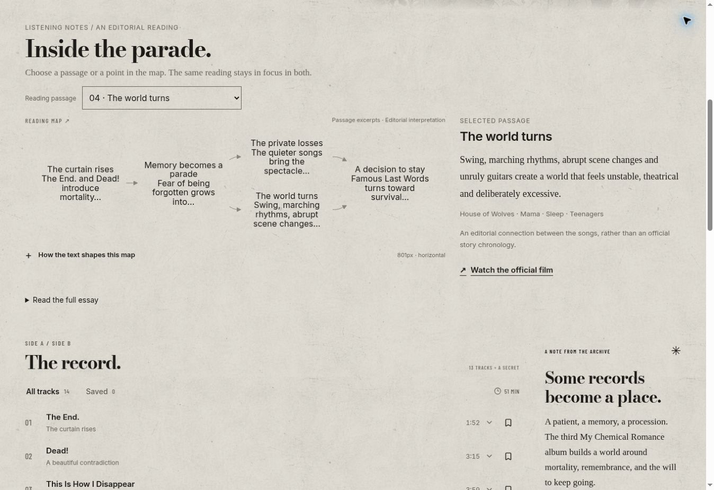
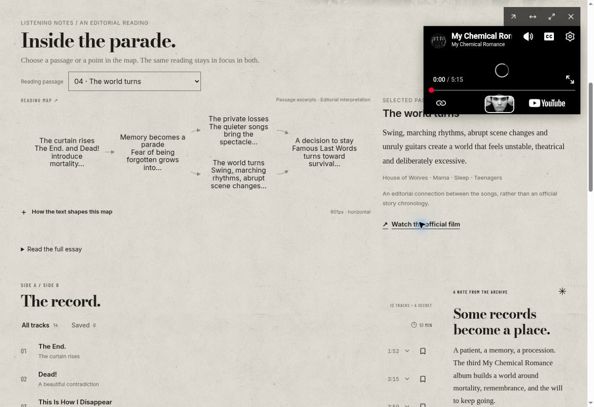
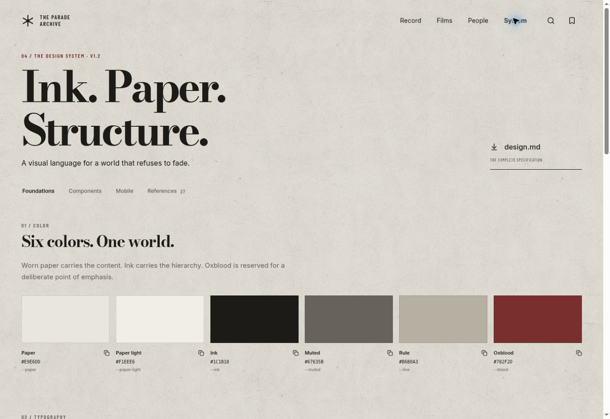

<div align="center">

<p><strong>THE BLACK PARADE · VOLUME 003</strong></p>

# Black Parade Design System

**Ink. Paper. A record that stays with you.**

A responsive React + TypeScript design system and working music archive,<br />
inspired by the worn album sleeve and theatrical world of My Chemical Romance’s <em>The Black Parade</em>.

<p>
  <a href="#run-locally">Run locally</a> ·
  <a href="design.md">Design specification</a> ·
  <a href="docs/component-api.md">Component API</a> ·
  <a href="docs/pretext-mermaid-proof.md">Pretext + Mermaid proof</a>
</p>

<p><strong>v1.2</strong> &nbsp; / &nbsp; React 19 &nbsp; / &nbsp; TypeScript &nbsp; / &nbsp; Vite &nbsp; / &nbsp; CSS</p>

</div>



<p align="center"><sub>The working example site, captured in the browser. The screenshots below show the same application and components included in this repository. <a href="docs/screenshots/README.md">Capture details</a></sub></p>

## A visual language with a working system behind it

Worn pale paper, black ink and restrained oxblood set the material. Bodoni Moda gives the headlines their scale; Inter keeps controls clear; Georgia carries the longer reading passages. Navigation sits directly on the canvas, and typography, spacing and alignment establish the page structure. The texture is a static image underneath the content.

The repository includes **12 reusable foundation components**, typed design tokens, a synchronized reader and diagram, a compact persistent video player, and a complete example application. [design.md](design.md) is the implementation contract for the visual language, component behavior and responsive rules.

| Foundation | Decision |
| --- | --- |
| Material | Generated paper grain with a global intensity control and an optimized WebP asset |
| Color | Paper `#E9E6DD` · Ink `#1C1B18` · Oxblood `#782F2D` |
| Typography | Bodoni Moda display · Inter interface · Barlow Condensed labels · Georgia reading text |
| Structure | Open composition, plain-text navigation, square controls and compact content spacing |
| Reading | 17px prose on phones, 18px on wider screens, 1.8 line height and a 65ch maximum measure |
| Interaction | 44px minimum targets, visible focus, native dialogs and reduced-motion support |

## Small screens get the complete experience

<table>
  <thead>
    <tr>
      <th>Record / mobile</th>
      <th>Linked reading / mobile</th>
    </tr>
  </thead>
  <tbody>
    <tr>
      <td align="center"></td>
      <td align="center"></td>
    </tr>
    <tr>
      <td>The Index opens a plain-text contents dialog. Track rows, notes and saved actions remain available.</td>
      <td>The selected paragraph comes before the map. Diagram text stays at 16px while the graph changes direction.</td>
    </tr>
  </tbody>
</table>

The reader becomes two columns at 1000px. Below that width, prose and diagram stack in reading order. Forms use at least 16px input text, dialogs use dynamic viewport limits, and fixed player controls include safe-area padding. The bundled [responsive lab](public/responsive.html) renders the complete site at real iframe viewport widths from 320 to 1440px.

## Text and diagrams that stay connected



**Pretext actually controls the labels Mermaid renders.** The adapter waits for Inter, prepares the shared chapter text with `prepareWithSegments()`, and uses `layoutWithLines()` to calculate explicit line breaks and measured label widths. Those results become Mermaid label content and `minNodeWidth`; Mermaid then lays out and renders the graph. A resize reuses cached text preparation. An edit invalidates only the changed passage.

The paragraph, SVG node and selected track share stable chapter IDs. Select a node to read its passage, select a passage to highlight its node, or open a track’s reading link to reach the corresponding chapter. Editing the passage updates the prose and its graph label together.

Open **“How the text shapes this map”** in the example to inspect the generated source, width presets, preparation counts and actual SVG containment results. Default nodes show a literal six-word excerpt of the same passage. The disclosure can switch to complete paragraphs or an intentionally unwrapped comparison.

| Full-passage proof | 320px diagram space | 390px diagram space |
| --- | ---: | ---: |
| Pretext label budget | 116px | 151px |
| Rendered SVG width | 308px | 378px |
| Per-node line counts | 13 / 14 / 13 / 14 / 13 | 8 / 10 / 8 / 10 / 9 |
| New preparations after resize | 0 / 5 | 0 / 5 |
| Clipped labels | 0 | 0 |

These are recorded browser observations, not performance guarantees. The graph is an editorial interpretation of the album; it does not claim an official narrative chronology. Read the [integration proof](docs/pretext-mermaid-proof.md), [adapter source](src/lib/pretext-mermaid.ts) and [verification record](docs/verification.md) for the data flow and exact scope.

## Keep the film close, keep the page readable



The video surface is an actual YouTube embed with native playback controls. On desktop, the compact 360px player docks at either upper corner. On phones, it uses the available width at the bottom and reserves enough document clearance to reach the final content.

A small tool strip provides the official-video link, docking, expansion and close actions. The same iframe remains mounted outside page-switching branches as the user moves through the archive. This is an **in-page miniplayer**; browser-native PiP is not implemented or claimed. See [the player API](docs/component-api.md#5-videoplayer) and [video provenance](docs/video-provenance.md).

## The components are part of the product



The System page uses the same exported components as the rest of the archive. Its specimens include real state changes, form validation, a native dialog, color copying and global texture adjustment.

| Area | Exports |
| --- | --- |
| Actions | `Button`, `IconButton` |
| Content | `Tag`, `SectionHeading`, `MediaCard`, `EmptyState` |
| Inputs | `SearchField`, `TabBar`, `TextField`, `TextArea` |
| Feedback | `Dialog`, `Toast` |
| Foundation | `tokens`, `DesignTokens` |
| Product components | `PretextMermaid`, `VideoPlayer`, `ReadingPage` |

### Reuse a component

This example assumes the file lives in `src/`:

```tsx
import { useState } from 'react';
import { Button, Dialog, TextField } from './design-system';

export function NoteExample() {
  const [open, setOpen] = useState(false);

  return <>
    <Button onClick={() => setOpen(true)}>Leave your mark</Button>
    <Dialog open={open} onClose={() => setOpen(false)} title="Your note.">
      <TextField label="Title" placeholder="Something worth remembering" />
      <Button variant="secondary" onClick={() => setOpen(false)}>Done</Button>
    </Dialog>
  </>;
}
```

The foundation barrel imports its CSS. Load the bundled Fontsource families as shown in [src/main.tsx](src/main.tsx), or supply deliberate fallbacks. The diagram’s measurement contract requires **Inter 400 at 16px**. `ReadingPage` also needs `src/reading.css` in its host. Exact props, defaults and controlled-state examples are in the [component API](docs/component-api.md).

## Explore the example

| View | What works |
| --- | --- |
| **Record** · `#archive` | Fourteen tracks, expandable listening notes, saved-track filter, album-art viewer, Spotify links and the synchronized reading workspace |
| **Films** · `#films` | Four official-video entries and the shared compact player |
| **People** · `#community` | Search, filters, sorting, votes, saves, local post creation, nested replies and validation |
| **System** · `#system` | Live foundations, component states, mobile specimens, references and downloadable Markdown |

Global search opens with `/` or `Ctrl/Cmd + K`. A saved collection and the mobile Index connect the views. Community content is a **local browser demonstration**: starter discussions and counts are samples; new posts, replies, votes and saves use versioned, validated browser storage. There is no shared community backend.

## Run locally

Use **Node.js 22.18 or newer**. The lockfile resolves the dependencies, and embedded videos do not require a YouTube API key.

```sh
git clone https://github.com/julymeltdown/black-parade-design-system.git
cd black-parade-design-system
npm ci
npm run dev
```

Open the URL printed by Vite. Append `/responsive.html` to open the viewport lab.

```sh
npm run test:pretext  # Real Canvas-backed adapter tests
npm run typecheck    # TypeScript
npm run build        # TypeScript + production Vite build
npm run preview      # Serve the built application
```

This is a source repository and example application, not a published npm component package. Components can be imported within the project or copied with their required styles and notices.

## Documentation and source map

| Start here | Contents |
| --- | --- |
| [design.md](design.md) | Full v1.2 design contract and responsive behavior |
| [Component API](docs/component-api.md) | Actual exports, props and integration examples |
| [Pretext–Mermaid proof](docs/pretext-mermaid-proof.md) | Text measurement, generated source, geometry and reproducible checks |
| [Verification](docs/verification.md) · [JSON](docs/verification.json) | Measured results and remaining limits |
| [Reference study](docs/references.md) | Inspected design documents, clone sources and license findings |
| [Reading provenance](docs/reading-provenance.md) | Pinned CSS sources and adaptations |
| [Video provenance](docs/video-provenance.md) | Pinned iframe source and player implementation details |
| [Foundation source](src/design-system/) | Typed tokens, 12 components and foundation CSS |
| [Product components](src/components/) | The diagram and player with scoped styles |
| [Example pages](src/pages/) | Record, reading, films, people and System |
| [Assets](public/assets/) | Supplied imagery and the optimized paper texture |

## What was verified

The v1.2 [verification record](docs/verification.md) documents **6 adapter tests passed**, successful TypeScript checking and a production build. The final Archive reader was measured at **10 viewport widths from 320 to 1440px**: all five SVG nodes remained present, no labels were clipped, the graph fit its container, and the document had no horizontal overflow. Node selection, passage selection, keyboard navigation and synchronized editing were also exercised.

Those observations apply to managed Chromium. They do not certify physical iOS/Android behavior, every browser engine, or uninterrupted third-party playback. The native YouTube embed and controls loaded; autoplay, captions, fullscreen and continuous audio were not certified. Vite reports a size advisory for some optional Mermaid chunks. The full record keeps these limits explicit.

## Sources, media and notices

The reader includes scoped CSS adapted from **react-notion-x**, **Obsidian Minimal** and **Medium Editor**. The player’s iframe/container structure adapts **saddamarbaa’s YouTube clone**. Their pinned revisions, exact changes and complete MIT notices are retained in the [reading](docs/reading-provenance.md) and [video](docs/video-provenance.md) provenance documents and [docs/vendor](docs/vendor/).

Cynthia Ugwu, REJOUICE and Obys informed the open editorial composition. Spotify, YouTube and Reddit informed interaction research. The [reference audit](docs/references.md) distinguishes studies from source that was actually adapted.

The six supplied album and performance images are **not declared open-source assets**. The paper texture was generated from the visual character of the supplied cover and encoded to WebP; its lossless source is in [assets-source](assets-source/). Fonts and dependencies retain their own licenses. Software permissions do not grant rights to artwork, photography, artist identity or embedded video. No full lyrics or audio files are bundled. This is an independent fan-oriented design study, not an official My Chemical Romance product.
