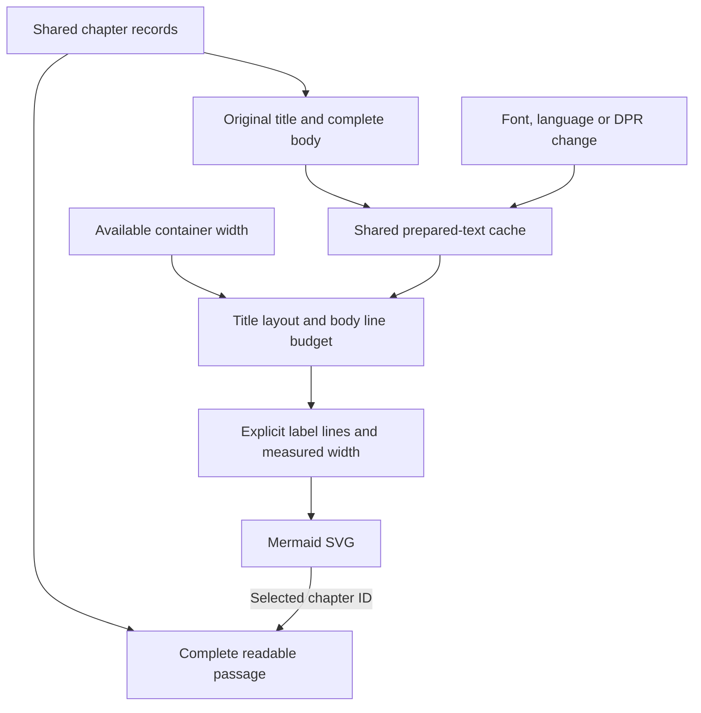

# Pretext → Mermaid: an explicit adapter

Version 1.3 · 11 November 2026

This implementation connects actual `@chenglou/pretext` text layout to actual Mermaid SVG rendering. Pretext does not include a Mermaid integration: [`src/lib/pretext-mermaid.ts`](../src/lib/pretext-mermaid.ts) is this project's adapter, and [`src/components/PretextMermaid.tsx`](../src/components/PretextMermaid.tsx) is its interactive React host. The adapter now shares the text-layout engine and font lifecycle used by the seven exported [Pretext components](pretext-components.md).

The visible reader and diagram import the same `CHAPTERS` records. In the default React view, a node contains its complete title and **up to three measured lines from the body**. The final body line reserves the measured ellipsis width. This is a prefix of the original paragraph; the implementation does not invent a separate summary or select a fixed number of words. The reader keeps the complete paragraph available, and the evidence disclosure can switch all nodes to full-passage labels.

This document describes the current implementation and how to inspect it. Current measured outcomes belong in [verification-v1.3.md](verification-v1.3.md). Earlier screenshots, six-test results and browser widths below are identified as **historical v1.2 evidence**. The graph itself is an editorial reading of the album's contrasts, not an official narrative chronology.

## Exact dependencies

| Package | Pinned version | Purpose |
| --- | --- | --- |
| `@chenglou/pretext` | `1.0.0` | Font measurement, prepared source handles and explicit line layout |
| `mermaid` | `12.3.0` | Flowchart topology, node placement and SVG rendering |
| `dompurify` | `3.4.17` | Additional SVG sanitization before insertion |
| `@fontsource-variable/noto-sans-kr` | `5.3.1` | Bundled Korean fallback font and Unicode-range subsets |
| `@napi-rs/canvas` | `0.1.100` | Development-only tests using a real Canvas font engine |

The manifest and lockfile are the version authority. Inter 400 is bundled through Fontsource. The graph uses `400 16px Inter, "Noto Sans KR Variable", sans-serif` and 17.6px line height, matching the adapter's Mermaid 12 classic SVG text contract. Node 22.18 or newer supports the repository's TypeScript-stripping test command.

## Data flow



1. **Load actual glyphs.** `ensureTextFonts()` calls `document.fonts.load(font, actualText)` for the shared title/body content. Passing the real text requests its Unicode-range subsets. The React host subscribes to the same text-environment revision as the other Pretext components.
2. **Prepare original source.** Each title and complete body receives its own `prepareWithSegments()` handle through `getPreparedText()`. The graph uses `whiteSpace: 'pre-wrap'`. It does not prepare a concatenated, width-specific excerpt string.
3. **Read the available content box.** A `ResizeObserver` reads the diagram container, not each rendered text label. The selected width is bounded by that box. The adapter derives a label-content budget after accounting for graph padding, branch/rank spacing and node padding.
4. **Lay out the complete title.** `layoutWithLines(preparedTitle, labelWidth, 17.6)` produces real title lines. The title is separate from the body budget and may itself wrap.
5. **Fit the body.** Default excerpt mode calls `clampParagraph(originalBody, labelWidth, 3, style)`. Full mode calls `layoutWithLines()` on the same original body handle. The clamp reserves the measured ellipsis width on its final line, advances through segment/grapheme cursors and materializes the actual retained prefix. It does not append an unmeasured ellipsis to an already full line.
6. **Feed geometry into Mermaid.** The escaped title/body line texts become explicit Mermaid label breaks. The widest measured line, rounded up, becomes `flowchart.minNodeWidth`. Mermaid then supplies its own graph layout and SVG geometry.
7. **Serialize Mermaid rendering.** `initialize()` and `render()` are queued together because Mermaid configuration is global. The adapter uses strict security, traditional quoted labels, `htmlLabels: false`, `dagre` layout and `classic` look.
8. **Sanitize and insert.** DOMPurify sanitizes the generated SVG, excluding `foreignObject`, scripts and event-handler attributes. The adapter parses the SVG, validates its root, imports it and inserts it with `replaceChildren()`.
9. **Connect selection.** Rendered nodes receive `data-chapter-id`, keyboard focus, button semantics and pressed state. Click or Enter/Space selects the matching readable passage. Selecting a passage changes the marked node without rebuilding the graph solely for selection.
10. **Check the rendered result.** After insertion, the browser verification inspects expected nodes, rendered label containment and intrinsic SVG width. These observations are exposed separately from the predicted text metrics.

## Shared preparation and invalidation

The [`pretext-layout.ts`](../src/lib/pretext-layout.ts) engine retains **512 prepared plain-text entries** by default. The cache uses least-recently-used eviction; a successful lookup refreshes the entry's recency. Its preparation key is:

```ts
[font, letterSpacing, whiteSpace, wordBreak, originalText]
```

**Width and line height are excluded.** Width changes where a prepared source wraps. Line height changes the predicted vertical geometry. Neither changes the glyph preparation. A resize therefore reuses the title and full-body handles; the selected excerpt is recomputed from those original handles. The ellipsis and space metrics use auxiliary prepared handles that are also cached and warmed before a later narrow resize needs them.

An ordinary body edit creates a key for that body's new source and leaves unaffected entries available. This is not an unlimited-cache guarantee: eviction and genuine environment changes can require fresh preparation. The operation counters report actual cache hits, misses, preparations, entries, layout passes and invalidations, not elapsed-time benchmarks. The rich-inline component owns a separate memoized handle; its work is not included in the plain-text cache counters.

The shared [`pretext-fonts.ts`](../src/lib/pretext-fonts.ts) lifecycle watches actual font-face identity, family/style/weight/stretch, Unicode ranges and load state. It also watches the document's `lang` and device pixel ratio. A changed font/subset fingerprint, language or DPR clears both this application's prepared cache and Pretext's internal cache, advances a revision, and notifies consumers. Regular container resizing does not invalidate the cache. Locale follows the document language globally; components do not set conflicting local locales.

The seven text components report `data-pretext-state="measured"` or `"native"` to distinguish an available measured plan from a native presentation. Font-loading or measurement failure leaves readable DOM content available. Manual-flow/truncation specimens use native paragraphs for Arabic, Hebrew and bidi-control content. These states do not certify rendered fit. The graph host separately reports rendering errors and actual SVG verification, with the complete reading passage remaining alongside it.

See the [layout-engine guide](pretext-layout-engine.md) for source-cursor semantics, balanced widths, line clamps, flow exclusions and measured row indexes. [Pretext provenance](pretext-provenance.md) records the inspected upstream patterns and retained license.

## Measurement modes and visible evidence

| Mode | Label content | Use of Pretext output |
| --- | --- | --- |
| Default excerpt | Complete title plus at most three measured body lines | Uses explicit measured breaks and widest-line node width; reserves an ellipsis only when the body is truncated |
| Full passage | Complete title and complete body | Lays out all source text using the same prepared title/body handles |
| Unwrapped comparison | The chosen title/body content in one traditional label | Deliberately omits Pretext's explicit breaks and minimum-node-width contribution; horizontal scrolling is allowed inside the diagram viewport |

The React host explicitly starts in excerpt mode. The low-level `buildMermaidPlan(chapters, availableWidth, pretextEnabled, labelMode)` retains `labelMode='full'` as its default for complete-text callers. It is important to distinguish the visible default from this function default when reproducing a test.

The **“How the text shapes this map”** disclosure exposes generated Mermaid source, per-node line counts, widest lines, predicted text heights, preparation counts and actual SVG containment. Its mode caption says whether the metrics describe three-line body excerpts or complete paragraphs. The controls provide fit/320/390/760px presets, a width slider, a synchronized `MeasuredTextArea` editor, full-passage labels and the unwrapped comparison.

Pretext changes two concrete Mermaid inputs: the label's explicit line text and `minNodeWidth`. The graph is not a fixed SVG shrunk until the type becomes small. It retains 16px labels, flows top-to-bottom below a 720px diagram space and left-to-right at or above that width. A selected 760px preset cannot make a 320px phone grow wider. The controlled geometry uses 6px node padding, 16px fork spacing, 22px rank spacing and 6px outer padding.

The padding budget reserves `4 * NODE_PADDING` per node because Mermaid 12's classic label helper and rectangle geometry both contribute horizontal padding. This rule comes from the adapter's inspected rendering path and earlier browser observations; current output is still checked after rendering.

## Reader synchronization API

This example lives in `src/` and uses a real React component:

```tsx
import { useState } from 'react';
import { PretextMermaid } from './components';
import { CHAPTERS, type ChapterId } from './lib/pretext-mermaid';

export function LinkedPassage() {
  const [selectedId, setSelectedId] = useState<ChapterId>('memory');
  const [edits, setEdits] = useState<Partial<Record<ChapterId, string>>>({});
  const selected = CHAPTERS.find(chapter => chapter.id === selectedId)!;

  return <>
    <PretextMermaid compact selectedId={selectedId} onSelect={setSelectedId}
      textOverrides={edits}
      onTextChange={(id, body) => setEdits(previous => ({ ...previous, [id]: body }))} />
    <article>
      <h2>{selected.title}</h2>
      <p>{edits[selected.id] ?? selected.body}</p>
    </article>
  </>;
}
```

Stable IDs are `curtain`, `memory`, `loss`, `theatre`, `resolve`. Each chapter includes `trackIds`, allowing the archive's track selection to reach its reading passage. The built-in editor limits a body to 480 characters and changes local/controlled state; persistence belongs to its caller. See the [component API](component-api.md#3-pretextmermaid) for exact props.

## Reproducible checks

```sh
npm ci
npm run test:pretext
npm run typecheck
npm run build
```

The test command runs `pretext-layout.test.mjs` and `pretext-mermaid.test.mjs` with real Canvas font metrics, plus `pretext-fonts.test.mjs` with a controlled FontFaceSet to test asynchronous loading and recovery. The layout suite covers cache capacity and recency, preparation keys, line-height reuse, balanced headings, measured ellipsis and grapheme boundaries, hard breaks, flow exclusions, prefix sums and visible row ranges. The Mermaid suite covers complete-text preservation, actual width-dependent line changes, three-line body excerpts, width/mode preparation reuse, single-body edits, hostile-label escaping and unchanged topology. Test source describes assertions; an execution result must still be recorded in [verification-v1.3.md](verification-v1.3.md).

Browser checks must separately inspect English/Korean/mixed text, widths, native fallback states, keyboard selection, synchronized edits and font-environment changes. The component's `data-pretext-verification` contains the observed node count, clipped labels, intrinsic SVG dimensions, available width and fit result. A successful UI status is computed from those observations; there is no hard-coded passed badge. Node Canvas tests do not certify browser SVG geometry or a physical phone.

### Historical v1.2 evidence

The previous [verification record](verification.md) and [JSON](verification.json) documented **6 adapter tests passed, 0 failed**, plus successful TypeScript checking and a production build. Those are the previous suite's results and are not the current suite's count. The original README screenshots also belong to that revision.

The v1.2 full-passage browser observations used the same five editorial paragraphs:

| Actual diagram space | Pretext label budget | Rendered SVG width | New preparations / five cached labels | Clipped labels |
| --- | --- | --- | --- | --- |
| 320px | 116px | 308px | 0 / 5 | 0 |
| 390px | 151px | 378px | 0 / 5 | 0 |

That revision reported 13/14/13/14/13 lines at 320px and 8/10/8/10/9 at 390px. Its default excerpt mode was checked at ten iframe viewport widths from 320 to 1440px with five nodes, contained labels and a fitting graph. Its separate padding investigation observed a 209px label minimum producing a 233px rectangle at configured 6px padding. These observations explain the earlier geometry decisions; they do not validate v1.3's new body-clamp policy, separate title/body cache handles or new components.

## Primary-source findings and limits

- [Pretext README](https://github.com/chenglou/pretext/blob/main/README.md) and [layout implementation](https://github.com/chenglou/pretext/blob/main/src/layout.ts) describe cached preparation, public line-layout APIs and font-loading requirements. Preparation measures with Canvas; width-only reflow uses prepared data. Consult the [pinned provenance audit](pretext-provenance.md) for the exact inspected revision rather than assuming upstream main stays unchanged.
- [Pretext package manifest](https://github.com/chenglou/pretext/blob/main/package.json) identifies the package, ESM entry points and license. The installed 1.0.0 API is the integration boundary here.
- [Mermaid API](https://mermaid.js.org/config/usage) documents initialization and asynchronous rendering. Its [flowchart schema](https://mermaid.js.org/config/schema-docs/config-defs-flowchart-diagram-config.html) describes the sizing and spacing controls used by the adapter.
- [Mermaid label geometry](https://github.com/mermaid-js/mermaid/blob/develop/packages/mermaid/src/rendering-util/rendering-elements/shapes/util.ts) connects minimum width to node geometry. [SVG text creation](https://github.com/mermaid-js/mermaid/blob/develop/packages/mermaid/src/rendering-util/createText.ts) uses browser text measurements and 1.1em line spacing. The installed version, not a future develop branch, controls this build.
- [Traditional-label processing](https://github.com/mermaid-js/mermaid/blob/develop/packages/mermaid/src/rendering-util/handle-markdown-text.ts) supports explicit breaks. The adapter uses quoted traditional labels and a deliberately large `wrappingWidth`, leaving the width-budget decision to Pretext.
- [Mermaid rendering and sanitation](https://github.com/mermaid-js/mermaid/blob/develop/packages/mermaid/src/mermaidAPI.ts) already sanitize strict-mode output. This adapter adds DOMPurify and a generated-only grammar; editor text is confined to labels, and arbitrary graph source/click directives are not accepted.

Pretext does not replace Mermaid's graph layout, remove all browser `getBBox()`/text-length reads, or guarantee identical shaping across engines. The synchronized native reader remains the primary long-form reading surface. Text geometry, browser painting and the final graph fit are distinct checks. Font fallback, bidi labels, browser minimum font settings and new font policies need corresponding validation before broadening support claims. The unwrapped comparison is clearly identified as a diagnostic mode; it permits local diagram scrolling without silently scaling the labels or intentionally overflowing the document.
