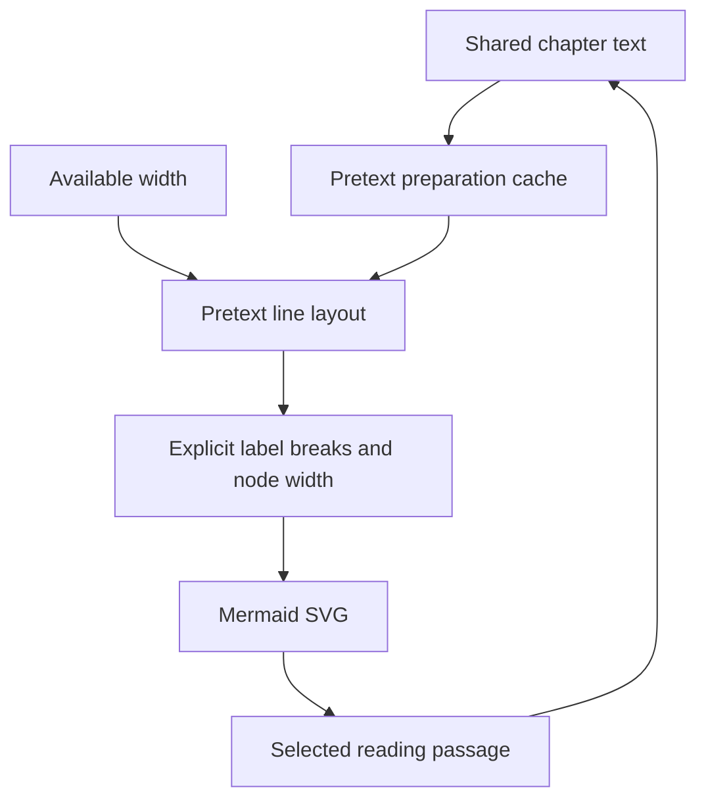

# Pretext → Mermaid: an explicit, working adapter

This implementation connects actual `@chenglou/pretext` text layout to actual Mermaid SVG rendering. Pretext does not contain a Mermaid integration. The adapter in `src/lib/pretext-mermaid.ts` is the integration, and `src/components/PretextMermaid.tsx` is its interactive React host.

The visible reader and diagram import the same `CHAPTERS` records. The default graph labels contain the title and a **literal six-word prefix** of that record's body, followed by an explicit ellipsis. No separate summary is invented. The full paragraph remains readable next to the graph, and the evidence disclosure can switch every node to full-passage labels. The graph is an editorial interpretation of the album's contrasts, **not an official chronology or an asserted canonical story**.

## Exact dependencies

| Package | Installed version | Purpose |
| --- | --- | --- |
| `@chenglou/pretext` | `1.0.0` | Font measurement, cached preparation, explicit line layout |
| `mermaid` | `12.3.0` | Flowchart topology, node placement and SVG rendering |
| `dompurify` | `3.4.17` | Additional SVG sanitization before DOM insertion |
| `@napi-rs/canvas` | `0.1.100` | Development-only reproducible tests with a real Canvas font engine |

Versions are pinned in `package.json` and resolved in `package-lock.json`. Node 22.18+ is recommended for the TypeScript-stripping test command; the managed validation runtime is Node 24.22.1.

## Data flow



1. Wait for the bundled Inter font with `document.fonts.load('400 16px Inter', text)` and `document.fonts.ready`.
2. The chosen label mode projects the same chapter into either its title plus the first six words, or its title plus full body. `prepareWithSegments(text, font, { whiteSpace: 'pre-wrap' })` measures that exact displayed text once. A bounded cache is keyed by the font and exact projected text.
3. A `ResizeObserver` reads the available **container** width. The adapter derives a node content budget after reserving node padding, graph padding and rank spacing.
4. `layoutWithLines(prepared, labelWidth, 17.6)` computes the exact line text, width, count and predicted text height. Width-only changes reuse the existing prepared handles.
5. The adapter escapes each output line and joins the lines using explicit Mermaid label breaks. The maximum computed line width feeds `flowchart.minNodeWidth` directly.
6. Mermaid receives the generated definition. The adapter queues `initialize()` and `render()` together because Mermaid configuration is global.
7. The SVG is sanitized, parsed with `DOMParser`, checked, imported and inserted through `replaceChildren()`. It is not an untrusted `dangerouslySetInnerHTML` payload.
8. SVG nodes receive `data-chapter-id`, keyboard focus, button semantics and a selected state. Clicking or pressing Enter/Space selects the same chapter in the readable text. Reader selection updates the matching graph node without a complete graph rerender.

## Why this is meaningful integration

Two Pretext outputs change Mermaid's result:

- **Line text:** the generated Mermaid source changes when the available width changes. It is not a fixed graph scaled down until its text becomes too small.
- **Measured line width:** `minNodeWidth` receives the widest Pretext line, rounded up, before Mermaid constructs its node geometry. Node padding is then added by Mermaid.

The evidence disclosure in the running component exposes the generated source, per-passage line counts/widths/heights, new preparation count, actual rendered SVG width and post-render label containment results. Its metrics explicitly identify whether they describe six-word excerpts or full passages. The same disclosure provides 320px, 390px, 760px and available-width choices, a width slider, editable synchronized passage text, a full-passage checkbox and an unwrapped Mermaid comparison.

The graph preserves 16px text. At narrow sizes it flows top-to-bottom with a two-way branch; when sufficient width is available it flows left-to-right over four ranks. The width chooser is bounded by actual available space. Selecting 760px on a 320px phone does not make the page wider than the phone. The adapter explicitly chooses Mermaid's `dagre` layout and `classic` look: Mermaid 12's default ELK/neo combination does not use the same padding and spacing rules. The controlled geometry uses 6px node padding, 16px fork spacing, 22px rank spacing and 6px outer padding.

## Reader synchronization API

```tsx
import { useState } from 'react';
import { PretextMermaid } from '../components/PretextMermaid';
import { CHAPTERS, type ChapterId } from '../lib/pretext-mermaid';

const [selectedId, setSelectedId] = useState<ChapterId>('memory');
const [textOverrides, setTextOverrides] = useState<Partial<Record<ChapterId, string>>>({});
const selected = CHAPTERS.find(chapter => chapter.id === selectedId)!;

<PretextMermaid
  compact
  selectedId={selectedId}
  onSelect={setSelectedId}
  textOverrides={textOverrides}
  onTextChange={(id, body) => setTextOverrides(previous => ({ ...previous, [id]: body }))}
/>
<article>
  <h2>{selected.title}</h2>
  <p>{textOverrides[selected.id] ?? selected.body}</p>
</article>
```

Stable IDs are `curtain`, `memory`, `loss`, `theatre`, `resolve`. Each chapter also lists `trackIds`, so opening a track can select its relevant reading passage.

## Reproducible checks

```sh
npm ci
npm run test:pretext
npm run typecheck
npm run build
```

The Node tests use the actual bundled Inter WOFF2 font registered with a real Skia-backed Canvas engine. They check complete text preservation, line widths at 280/320/390/760px, actual changes in line breaks, preparation reuse, single-passage invalidation, hostile-label escaping and topology preservation. They do not pretend that Node font measurements certify browser SVG geometry.

Observed local result: **6 tests passed, 0 failed** with the locked dependencies. The added excerpt test proves that every displayed prefix comes directly from its full passage and that full-passage mode retains complete text. TypeScript checking also passed before browser integration verification.

Final browser observations in full-passage mode, with the same five paragraphs:

| Actual diagram space | Pretext label budget | Rendered SVG width | New preparations after resize | Clipped labels |
| --- | --- | --- | --- | --- |
| 320px | 116px | 308px | 0 / 5 | 0 |
| 390px | 151px | 378px | 0 / 5 | 0 |

At 320px, the complete paragraphs produced 13/14/13/14/13 lines. At 390px, the same complete paragraphs produced 8/10/8/10/9 lines. Both graphs fit their available width. These are results read from the executing browser's evidence panel.

The final default excerpt mode was checked at ten actual iframe viewport widths from 320 to 1440px. All five nodes existed, no labels exceeded node bounds, and every graph fit its content container. See [verification.md](verification.md) and [verification.json](verification.json) for the readings and verification limits.

The padding calculation reserves `4 * NODE_PADDING` per node. Mermaid 12 classic label preparation and rectangle geometry both contribute horizontal padding. The browser showed a 209px label minimum producing a 233px rectangle with configured 6px padding; reserving only twice that padding caused the earlier overflow and was corrected.

The component separately checks the **rendered browser SVG** after insertion: all five expected nodes must exist, each label's rendered bounds must stay within its node's bounds, and the intrinsic SVG width must fit the available space. The result is exposed as `data-pretext-verification` and displayed in the evidence disclosure. A successful check is reported only from those observed values; errors are not hidden behind a hard-coded “passed” label.

## Primary-source findings and limits

- [Pretext README](https://github.com/chenglou/pretext/blob/main/README.md) and [actual layout implementation](https://github.com/chenglou/pretext/blob/main/src/layout.ts) document cached preparation, the `layoutWithLines()` result, font-loading requirements and supported wrapping behavior. Preparing text uses Canvas; the width-only layout path is arithmetic.
- [Pretext package manifest](https://github.com/chenglou/pretext/blob/main/package.json) confirms the package name, ESM entry point, version and MIT license.
- [Mermaid API](https://mermaid.js.org/config/usage) documents initialization and async rendering. [Its flowchart configuration schema](https://mermaid.js.org/config/schema-docs/config-defs-flowchart-diagram-config.html) documents the sizing and spacing controls used here.
- [Mermaid label geometry](https://github.com/mermaid-js/mermaid/blob/develop/packages/mermaid/src/rendering-util/rendering-elements/shapes/util.ts) shows `minNodeWidth` entering actual label geometry. [SVG text creation](https://github.com/mermaid-js/mermaid/blob/develop/packages/mermaid/src/rendering-util/createText.ts) uses 1.1em line spacing and browser text measurements.
- [Traditional-label processing](https://github.com/mermaid-js/mermaid/blob/develop/packages/mermaid/src/rendering-util/handle-markdown-text.ts) supports explicit label breaks. The source notes a limitation with `markdownAutoWrap: false` and non-HTML labels. This adapter instead uses traditional quoted labels and a deliberately high `wrappingWidth` so Mermaid does not make a second wrapping decision for these short, bounded labels.
- [Mermaid rendering and sanitation](https://github.com/mermaid-js/mermaid/blob/develop/packages/mermaid/src/mermaidAPI.ts) already sanitize strict-mode output. The extra DOMPurify pass and generated-only grammar keep editor content confined to labels. Arbitrary Mermaid source and click directives are not accepted.

Pretext does **not** replace Mermaid's graph layout, remove all Mermaid `getBBox()`/text-length reads, or guarantee identical shaping across all browsers. The synchronized reader is the primary long-form reading surface. SVG line layout is independently verified in the executing browser. Font fallback, mixed-direction text, unusual browser minimum font settings and different browser engines still require validation if the content/font policy is expanded.

The unwrapped comparison deliberately permits horizontal scrolling inside the diagram viewport. Its overflow is clearly identified as the baseline; it does not make the entire page overflow or silently shrink the text.
